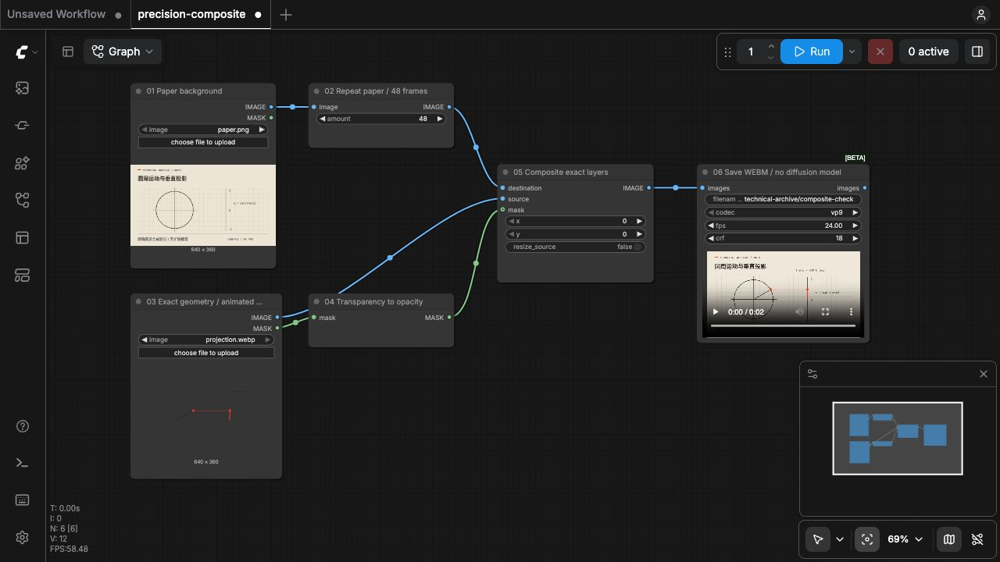
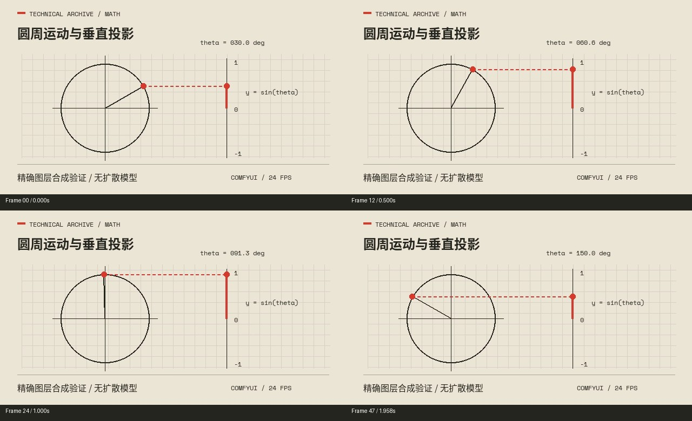

# ComfyUI Technical Explainer Kit

**技术档案图解科普制作包 · 面向工程、数学与相关知识的 ComfyUI 视频制作**

用纸面、照片拼贴、工程网格和克制标注组织知识，通过比较、拆解、测量、连接与运行把原理讲清楚。本仓库提供可复用的风格规范、选题与分镜模板、节点提示词，以及一个实际运行过的 ComfyUI 精确图层合成工作流。

视觉风格：**复古技术档案 × 动态图解科普**。NASA 参考视频提供视觉语言；新选题可以是齿轮、桥梁、矩阵、概率、缓存或其他可解释的知识。

[快速运行](#快速运行) · [适用题材](#适用题材) · [同事复用流程](#同事复用流程) · [文档导航](#文档导航)

## ComfyUI 实测截图



上图是实际 ComfyUI 画布，包含输入、蒙版转换、图层合成与视频预览。验证环境为 ComfyUI **0.34.0**、前端 **1.49.6**；运行使用核心节点，禁用自定义节点和 API 节点。



示例将预先计算的圆周运动与投影图层合成到纸面底图，输出 **640×360、24fps、2 秒、48 帧的无声 WEBM**。可下载或查看 [验证视频](comfyui/verification/composite-check.webm)。

这个简洁数学示例验证精确图层的合成与导出。完整风格还包括深色桌面、实物照片、叠纸和机制拆解，见 [风格说明](references/STYLE_GUIDE.md)。

## 提供什么

| 内容 | 用途与验证范围 |
| --- | --- |
| 风格、选题、文案与分镜模板 | 为新主题组织叙事、素材和解释动作 |
| ComfyUI 图像与视频节点提示词 | 接入团队已有模型与工作流；本仓库未运行生成模型推理 |
| 六节点精确合成工作流 | 已实际运行，输入素材与两种 JSON 均随包提供 |
| 运行截图、输出帧图与验证视频 | 展示已验证的链路；检查细节见 [验证记录](references/COMFYUI_VERIFICATION.md) |
| 完整字体与对应许可 | 用于中文、拉丁标题与技术标签的排版 |
| 可选 AI 技能入口 | 辅助策划；`SKILL.md` 由支持技能的 AI 工具读取 |

使用本包制作新片仍需选题资料、模型、素材、录音和时间轴。随附工作流不包含文生图、图生视频、配音、字幕编排或整片自动生成；这些环节需要接入团队已有流程。

## 适用题材

最适合能展示**结构、方向、比例、数量、路径、前后状态或因果变化**的主题。

| 方向 | 选题示例 | 画面怎样解释 |
| --- | --- | --- |
| 机械与制造 | 齿轮变速、差速器、切削与增材制造 | 拆解、啮合、旋转、逐层成形 |
| 土木与结构 | 桁架、拱、载荷路径 | 加载、分解、传递、方案对比 |
| 电路、控制与热流 | 反馈纠偏、滤波器、换热器 | 追踪信号与通道，对比输入输出 |
| 几何与微积分 | 面积重排、割线到切线、积分累积 | 对齐、分割、靠近、细分与累积 |
| 线性代数、概率与波 | 矩阵变换、条件概率、傅里叶叠加 | 变换网格、筛选样本、叠加波形 |
| 算法与技术史 | 路径搜索、缓存、标准的形成 | 状态推进、数据流、资料对照 |

长篇形式证明、高维抽象与数值模拟需要额外的公式推导、投影说明或计算数据。完整选题表与改编建议见 [适用题材](references/TOPIC_FIT.md)。

数学主题以研究纸面、坐标、几何对象和公式为主体；工程主题可用设备、剖面和手册。按主题选择对象，不要求航天背景。

## 快速运行

已有 ComfyUI 的同事可先运行随包验证，**无需扩散模型、模型权重、API Key 或额外自定义节点**。输入已生成，首次使用不用运行 Python 脚本。

1. 下载整个仓库并解压，将 [paper.png](comfyui/input/paper.png) 与 [projection.webp](comfyui/input/projection.webp) 上传到你的 ComfyUI 输入目录。保持 `projection.webp` 为原始动画文件。
2. 将 [precision-composite.json](comfyui/precision-composite.json) 拖入 ComfyUI 画布。
3. 在两个 `LoadImage` 节点中分别选中已上传的底图与动画图层；上传后文件名若变化，以节点中的实际选择为准。
4. 确认六个节点均可用，背景批次为 `48`，`SaveWEBM` 帧率为 `24`，点击 **Run**。
5. 在预览与 ComfyUI 输出目录查看 2 秒结果。默认输出前缀为 `technical-archive/composite-check`；核对纸面、圆周上的点、投影点与虚线均可见。

工作流连接：

```text
LoadImage(paper.png) → RepeatImageBatch(48) ───────→ destination
LoadImage(projection.webp) → IMAGE ──────────────→ source
                          → MASK → InvertMask ──→ mask
                         ImageCompositeMasked → SaveWEBM
```

`InvertMask` 用于将输入透明度蒙版转换为合成所需的不透明度；背景复制为 48 帧以匹配图解动画。修改演示帧数时需同步调整背景批次。

| 文件 | 打开方式 |
| --- | --- |
| [precision-composite.json](comfyui/precision-composite.json) | 拖入 ComfyUI 画布的工作流 |
| [precision-composite-api.json](comfyui/precision-composite-api.json) | API 执行节点图，供调用端提交到 `/prompt` 时使用 |

出现缺失节点时，先对照 [验证环境与限制](references/COMFYUI_VERIFICATION.md) 检查版本和节点导入状态。其他版本、显卡、模型及插件组合需在各自环境验证。

## 同事复用流程

1. **确定问题**：填 [选题表](references/BRIEF_TEMPLATE.md)，写清观众、核心问题、最终结论和资料。
2. **组织故事**：把选题表与 [策划提示词](references/PROMPT.md) 交给编导或语言模型，形成文案和解释顺序。
3. **规划图层**：用 [分镜模板](references/STORYBOARD_TEMPLATE.md) 明确每句台词对应的对象、变化、关系与阅读停留。
4. **制作素材**：在已有 ComfyUI 图像或视频流程中使用 [节点提示词](references/COMFYUI_PROMPTS.md)，另行制作精确知识图层。
5. **按录音排片**：以实际录音的词或短语时间戳驱动画面、字幕和音效；先验证核心样段，再扩展全片。
6. **记录检查**：使用 [检查表](references/CHECKLIST.md)，保留工程、输入、模型与节点版本、来源和真实验收状态。

**生成与精确图层分开处理。** 模型可生成纸面、材质、场景和允许变化的展示镜头；公式、坐标、受力箭头、电路连接、尺寸、字幕与关键机构关系需计算、绘制或核实后合成。固定种子不能保证结构与运动准确。

策划提示词面向编导或语言模型；节点提示词面向对应文本条件节点。`SKILL.md` 是可选 AI 入口，保留 `nasa-archive-explainer` 标识，不能当作 ComfyUI 插件安装。

可直接改写的任务指令：

```text
按“复古技术档案 × 动态图解科普”风格，
规划关于【主题】的【时长】中文视频，面向【观众】。
核心问题是【问题】，最终要理解【结论】，资料见【资料】。
团队使用 ComfyUI，已有模型与工作流为【填写；未知则待确定】。
本次交付【文案 / 文案与分镜 / 样段 / 完整影片】。
分别输出策划、节点提示词、精确图层任务与镜头表。
镜头表写清台词锚点、对象、变化、解释事实和阅读停留。
尚未录音的时间锚点标“待校准”，不要写成实测时间。
```

## 文档导航

| 文档 | 内容 |
| --- | --- |
| [风格说明](references/STYLE_GUIDE.md) | 叙事、材料、配色、字体、版式、解释动作与声音 |
| [适用题材](references/TOPIC_FIT.md) | 工程与数学选题、精度要求及改编建议 |
| [ComfyUI 制作说明](references/COMFYUI_GUIDE.md) | 素材、精确图层、时间轴与合成的分工 |
| [节点提示词](references/COMFYUI_PROMPTS.md) | 面向图像与视频节点的短提示词 |
| [实测记录](references/COMFYUI_VERIFICATION.md) | 环境、运行结果、检查与未验证范围 |
| [策划提示词](references/PROMPT.md) | 交给编导或语言模型的完整任务模板 |
| [选题表](references/BRIEF_TEMPLATE.md) | 每个新项目填写的需求 |
| [分镜表](references/STORYBOARD_TEMPLATE.md) | 台词、对象、动作、关系与时间锚点 |
| [检查表](references/CHECKLIST.md) | 样段与全片交付检查 |
| [来源说明](references/SOURCES.md) | 原片署名、示例来源与复用范围 |
| [第三方说明](THIRD_PARTY_NOTICES.md) | 字体版权归属与许可 |

## 仓库结构

```text
.
├── README.md
├── SKILL.md                      # 可选 AI 技能入口
├── THIRD_PARTY_NOTICES.md
├── requirements-demo.txt         # 仅重建演示输入时使用
├── agents/                       # AI 技能展示配置
├── references/                   # 风格、选题、提示词与模板
├── comfyui/
│   ├── precision-composite.json
│   ├── precision-composite-api.json
│   ├── make_demo_inputs.py
│   ├── input/                    # 可直接使用的验证输入
│   └── verification/             # 画布截图、输出帧图与视频
└── assets/
    ├── reference/                # 自制功能图解示例
    ├── fonts/                    # 完整字体
    └── licenses/                 # 字体许可原文
```

## 可选：重建演示输入

只有修改或重建演示图层时才需要此步骤。输入生成脚本使用 Pillow 与随包字体，不调用 ComfyUI 或生成模型。测试时使用 Python **3.13.12**、Pillow **12.3.0**。

在仓库根目录运行：

```bash
python3 -m venv .venv
.venv/bin/python -m pip install -r requirements-demo.txt
.venv/bin/python comfyui/make_demo_inputs.py
```

Windows 可使用 `.venv\Scripts\python.exe -m pip install -r requirements-demo.txt` 安装，再用同一解释器运行脚本。脚本会重建 `comfyui/input/paper.png` 与 `projection.webp`。

## 参考与复用

视觉参考：路北路陈《设计风格小课 04》，Bilibili 视频标识 `BV1Tsps6kE6z`。原片入口与各类素材说明见 [来源说明](references/SOURCES.md)。本仓库收录自制演示与 ComfyUI 截图；原片视频、音轨及截帧未随仓库分发。

配色与字体是团队复现选型，不能当作原作者工程参数。新主题需重新组织资料、故事与措辞，并记录所用素材的来源。

字体分别遵循 SIL Open Font License 1.1，原许可保留在 [assets/licenses](assets/licenses/)。本项目其余内容尚未指定统一的开源许可证；具体复用授权需由维护者另行说明。
