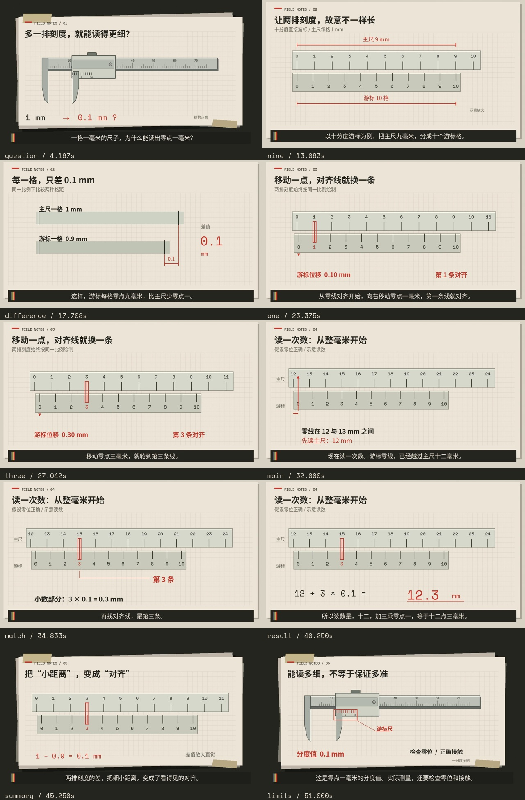
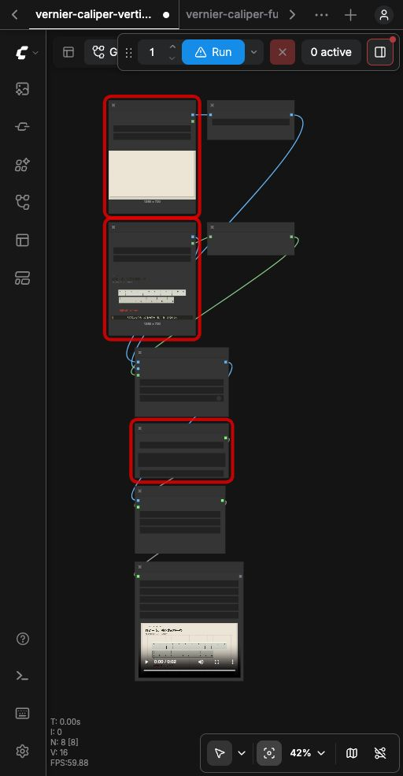
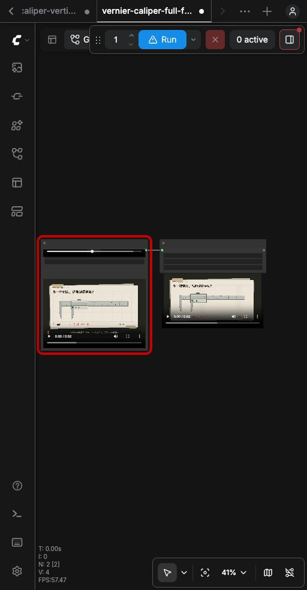

# 游标卡尺完整案例

主教程见[仓库首页](../../README.md)。这里提供实际制作的 52 秒中文讲解预览、全部合成输入、26 个分段工作流、整片导出工作流、脚本、实测时间轴和检查记录。

[播放或下载完整视频](vernier-caliper.mp4)



## 先运行一个会动的片段

1. 启动你的 ComfyUI。
2. 从本目录 `input/` 取出 `paper.png`、`05-one-02.webp`、`05-one-02.wav`，放入 ComfyUI 当前使用的输入目录。使用节点上传时保持原动画文件，不要先转成静态图片。
3. 将 [05-one-02.json](workflows/05-one-02.json) 拖入画布；不要拖同名 `-api.json`。
4. 在背景 `LoadImage`、前景 `LoadImage`、`LoadAudio` 三个节点重新选择对应文件。
5. 确认 `RepeatImageBatch` 为 `60`、`CreateVideo` 为 `24fps`，点击 **Run / 运行**。
6. 预期输出为约 2.5 秒带声 MP4，展示游标向右滑动并突出第一条对齐线。这是句子中间的一小段，旁白前后不完整属于分段结果。

输出位于 ComfyUI 的 `output/vernier/`，文件名带自动序号。不要把背景与前景两个输入选反。



截图保留当时前端的红色预检边框；实际运行成功。成功依据是队列历史与生成的视频，见[前端执行记录](review/ui-execution.json)。

## 再运行整片导出

1. 将 `input/vernier-caliper-assembled.mp4` 放入 ComfyUI 输入目录。
2. 导入 [full-film.json](workflows/full-film.json)。
3. 在 `LoadVideo` 中选择该文件，点击 **Run**。
4. 预期得到约 52.08 秒、1280×720、24fps、中文配音的 MP4；输出前缀为 `vernier-caliper-final`。

这一步输入是已经拼接好的视频，作用是复现整片读取和保存。要从 26 组素材重新合成全片，见下方脚本路线。



## 文件怎么看

| 文件 | 用途 |
| --- | --- |
| `vernier-caliper.mp4` | 已完成的制作预览 |
| `BRIEF.md` | 内容范围、理想模型和资料依据 |
| `timeline.json` | 实际短语录音的时间锚点；全片单位为秒，`phrases` 为句内偏移 |
| `chunks.json` | 分段顺序、帧数、背景、动画及声音文件名 |
| `input/*.png` | 静态纸面、深色桌面 |
| `input/*.webp` | 含精确刻度、动作、标题、字幕的透明动画 |
| `input/*.wav` | 每段声音与统一的 `narration.wav` |
| `input/vernier-caliper-assembled.mp4` | FFmpeg 拼接结果，作为整片 ComfyUI 导出输入 |
| `workflows/*.json` | 拖入画布使用；`-api.json` 交给程序调用 |
| `scripts/` | 素材生成、批量合成、拼接导出与检查 |
| `review/*-execution.json` | 原前端操作与仓库复跑的真实执行记录；重新运行会产生你的记录 |
| `review/verification.json` | 输出解码、刻度与文字边界检查 |
| `review/glyph-check.json` | 原制作的实际字体覆盖检查 |

本次没有使用扩散模型、图生视频模型、API Key 或自定义节点。工具外形为原创功能示意，精确图解由 Pillow 计算绘制；ComfyUI 合成、装载声音并编码；FFmpeg 负责分段拼接；最终再交给 ComfyUI 保存。

## 可选：批量重新合成 26 段

此路线适合能使用终端的同事。只运行现成画布不需要这一节。

### 1. 准备独立制作环境

需要 Python、FFmpeg 和 FFprobe。FFmpeg 要放进系统 PATH，使终端能执行 `ffmpeg -version` 和 `ffprobe -version`。以仓库根目录为当前目录：

macOS / Linux：

```bash
python3 -m venv .venv
.venv/bin/python -m pip install -r requirements-production.txt
```

Windows PowerShell：

```powershell
py -3 -m venv .venv
.\.venv\Scripts\python.exe -m pip install -r requirements-production.txt
```

本次原制作使用 Python 3.13.12。依赖安装在本仓库 `.venv` 中；ComfyUI 继续使用它自己的 Python 环境。

### 2. 让 ComfyUI 使用案例输入与输出目录

脚本按目录查找结果，需要 ComfyUI 与本案例使用相同的 `input/`、`output/`。先在 `examples/vernier-caliper/` 内新建 `output`、`temp`、`user` 三个文件夹；`user` 必须在启动前存在，否则会报目录不存在。

另起一个本地 ComfyUI 实例，使用空闲端口，例如 `8189`。在**你的 ComfyUI 源码目录**、使用**运行该 ComfyUI 的解释器**执行下面的参数模板：

```bash
python main.py --cpu --disable-all-custom-nodes --disable-api-nodes --cache-none --port 8189 --input-directory "/绝对路径/comfyui-technical-explainer-kit/examples/vernier-caliper/input" --output-directory "/绝对路径/comfyui-technical-explainer-kit/examples/vernier-caliper/output" --temp-directory "/绝对路径/comfyui-technical-explainer-kit/examples/vernier-caliper/temp" --user-directory "/绝对路径/comfyui-technical-explainer-kit/examples/vernier-caliper/user" --database-url "sqlite:///:memory:"
```

把四个目录替换成你电脑上的实际绝对路径。Windows 使用如 `D:/work/comfyui-technical-explainer-kit/examples/vernier-caliper/input`，并将 `python` 换成安装包自己的解释器路径；这不是在仓库制作 `.venv` 里启动 ComfyUI 的命令。桌面版用户若不熟悉启动参数，先使用前面的画布路线。

CPU 参数对应本次实测路线，合成示例不加载模型。若端口已占用，更换端口，并同步修改下一步的 `COMFYUI_URL`。

### 3. 从仓库根目录执行

macOS / Linux：

```bash
export COMFYUI_URL=http://127.0.0.1:8189
.venv/bin/python examples/vernier-caliper/scripts/composite.py --scene one
.venv/bin/python examples/vernier-caliper/scripts/composite.py
.venv/bin/python examples/vernier-caliper/scripts/finish.py
.venv/bin/python examples/vernier-caliper/scripts/verify.py
```

Windows PowerShell：

```powershell
$env:COMFYUI_URL = "http://127.0.0.1:8189"
.\.venv\Scripts\python.exe examples/vernier-caliper/scripts/composite.py --scene one
.\.venv\Scripts\python.exe examples/vernier-caliper/scripts/composite.py
.\.venv\Scripts\python.exe examples/vernier-caliper/scripts/finish.py
.\.venv\Scripts\python.exe examples/vernier-caliper/scripts/verify.py
```

第一条合成命令先运行游标滑动的三个短批次；第二条合成命令继续全部批次，已成功输出的会跳过。`finish.py` 用 FFmpeg 按帧拼接，使用统一配音，再请求 ComfyUI 导出全片；它会更新本目录的 `vernier-caliper.mp4`。检查结果写入 `review/verification.json`。

修改某一场景的输入后，需用 `composite.py --scene 场景ID --force` 强制重算，避免复用旧输出。场景 ID 见 `timeline.json`，例如 `one`、`three`、`match`。

### 4. 需要修改精确动画时

```bash
.venv/bin/python examples/vernier-caliper/scripts/build.py --scene three
```

此命令根据已有的录音时间轴重新绘制场景。Windows 换用上述 `.venv\Scripts\python.exe`。字体从仓库 `assets/fonts/` 读取；不是从作者电脑的目录读取。

`build.py` 中 `LINES` 是旁白，`scene_layer()` 及辅助函数是具体画面实现。本脚本专用于游标卡尺；将标题改为“齿轮”不会自动产生齿轮动画。新主题要重新实现对应关系。

只有 macOS 具备 `say` 且安装 Tingting 时，才可加 `--regenerate-audio` 重做合成配音与实测时间轴；其他系统可直接用随包声音重建现有图层。改变旁白必须同步重做声音、短语锚点、字幕、动画和分段，再合成全部片段，不能仅修改 `LINES` 后复用旧时间轴。

## 实测与限制

原制作：2026-10-31；ComfyUI 0.34.0、前端 1.49.6、Python 3.13.12、PyTorch 2.12.1 CPU、Pillow 12.3.0、PyAV 18.1.0。输入与脚本路径已整理为仓库相对路径，JSON 读写明确使用 UTF-8。

整理入仓库后，另起隔离 ComfyUI 实例，使用本目录的输入、工作流与脚本，重新执行全部 26 段、FFmpeg 拼接及 ComfyUI 整片导出。详见[仓库复跑记录](review/REPLAY.md)。Windows 命令按对应路径语法提供，尚未在 Windows 电脑实际运行。

完整预览为 1250 帧、52.083333 秒。已完整解码，检查音轨存在、226 个滑动帧的零线标记、196 项文字的画幅边界、刻度数学关系及字体覆盖，并抽取关键词附近连续帧。自动检查不等于完整正常速度人工有声语义验收；该项未记为通过。

原制作日志读取动画 WebP 时有 PyAV 解码提示，随后由图像序列路线成功读取。前端初次导入也出现媒体预检提示，实际执行成功。不要把所有红框都当作无害：以你的队列错误信息、输入是否存在和输出是否完整判断。

本仓库没有打包原视频的画面、音轨、参考截帧或任何生成模型权重，也没有将生成模型方案标为实测。
