# 游标卡尺案例画廊

这些图片从随包的实际 52 秒 MP4 提取，每张图对应一个解释节拍。[帧号与时间点](review/scenes/frames.json)可用于核对；[生成脚本](scripts/build_docs_media.py)可重新生成本页素材。点击图片可以查看原图；点击 JSON 可以打开对应的 ComfyUI 画布工作流。

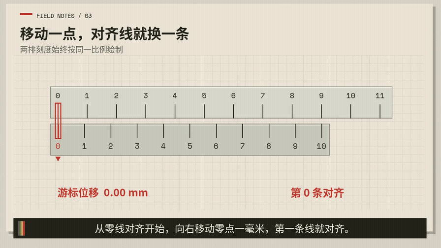

动图无声音，完整配音见[视频](vernier-caliper.mp4)。先跑一个片段的输入与结果如下：

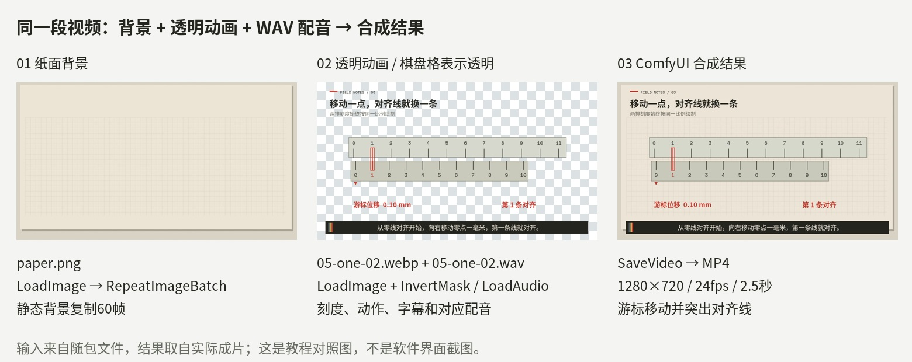

第一次运行建议从[2.5 秒带声片段教程](../../README.md#3-先跑通一个带声音的片段)开始，下载[八节点 JSON](workflows/05-one-02.json)或[含工作流的原始 PNG](review/starter-workflow.png)，并准备教程列出的三个输入文件。

## 1. 从问题进入

[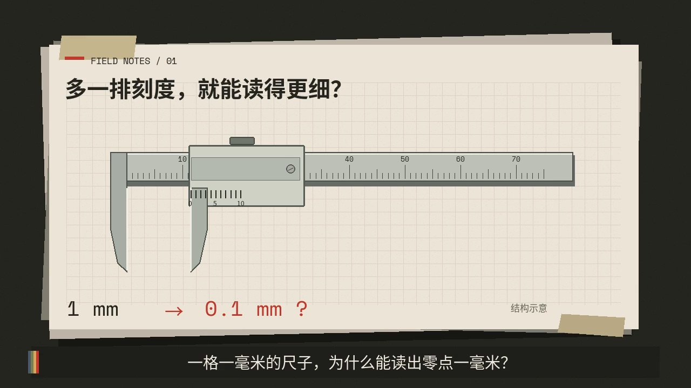](review/scenes/01-question.jpg)

旁白先提出测量疑问，再展示游标卡尺的主尺与滑动部分。

对应工作流：[01-question-01.json](workflows/01-question-01.json)、[01-question-02.json](workflows/01-question-02.json)

## 2. 指出会滑动的部分

[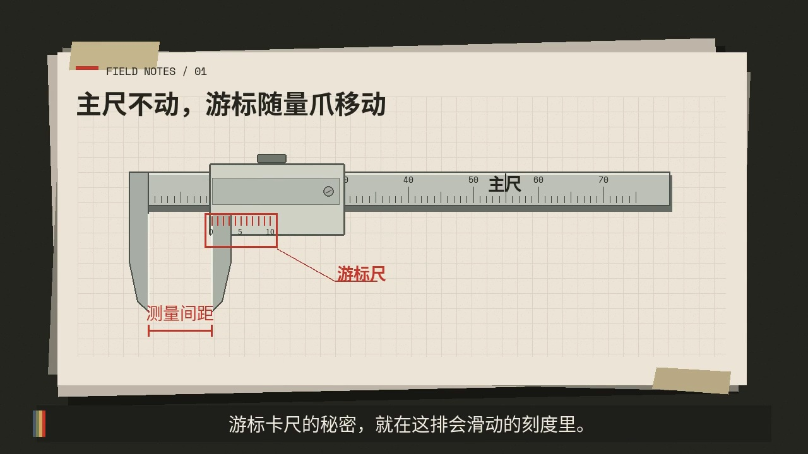](review/scenes/02-parts.jpg)

把观众注意力从完整工具带到真正参与读数的游标刻度。

对应工作流：[02-parts-01.json](workflows/02-parts-01.json)、[02-parts-02.json](workflows/02-parts-02.json)

## 3. 先比较两排刻度

[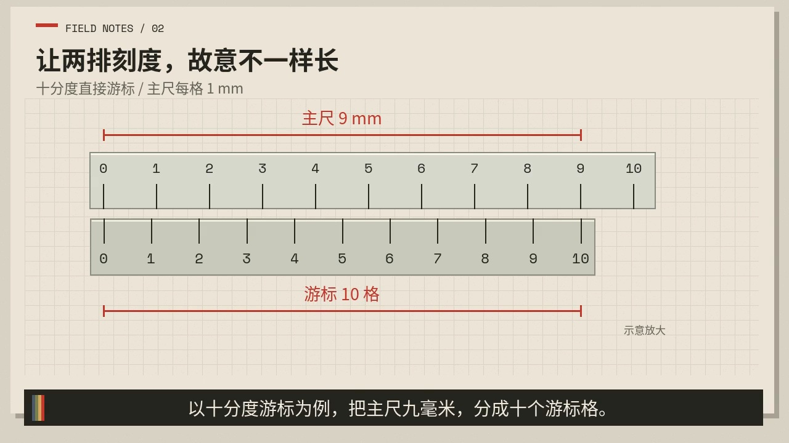](review/scenes/03-nine.jpg)

让两排刻度使用同一画面和同一比例，建立“十格对应九毫米”的条件。

对应工作流：[03-nine-01.json](workflows/03-nine-01.json)、[03-nine-02.json](workflows/03-nine-02.json)、[03-nine-03.json](workflows/03-nine-03.json)

## 4. 把差值变成可见距离

[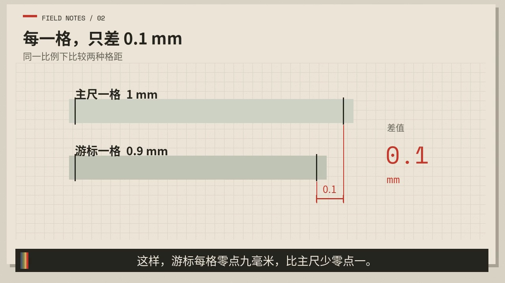](review/scenes/04-difference.jpg)

不是只在字幕里写“0.1mm”，而是把两种格距并列并标出差值。

对应工作流：[04-difference-01.json](workflows/04-difference-01.json)、[04-difference-02.json](workflows/04-difference-02.json)

## 5. 移动0.1mm后第一条线对齐

[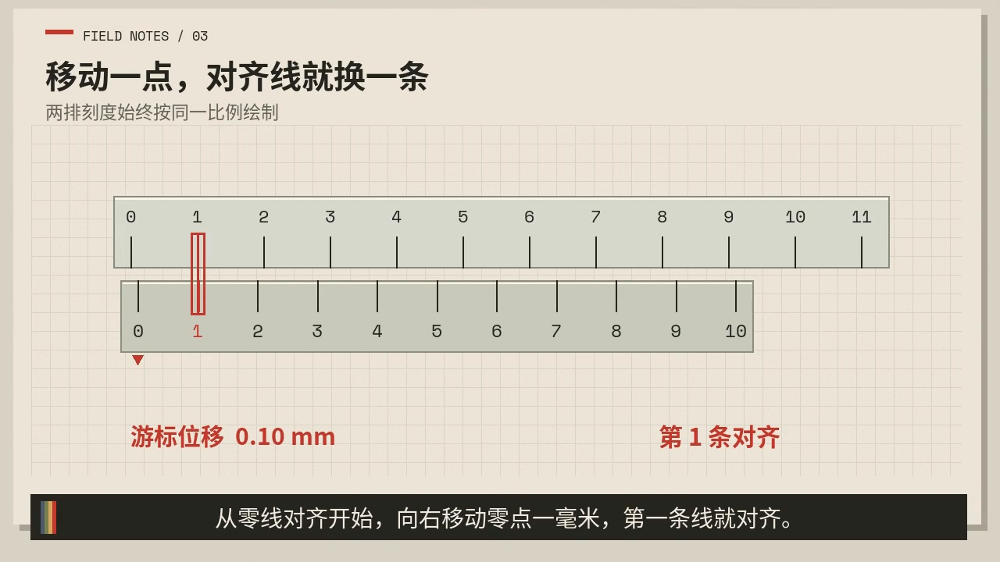](review/scenes/05-one.jpg)

动作和台词同时发生：游标从零线移动，第一条游标线与主尺线重合。

对应工作流：[05-one-01.json](workflows/05-one-01.json)、[05-one-02.json](workflows/05-one-02.json)、[05-one-03.json](workflows/05-one-03.json)

## 6. 移动0.3mm后第三条线对齐

[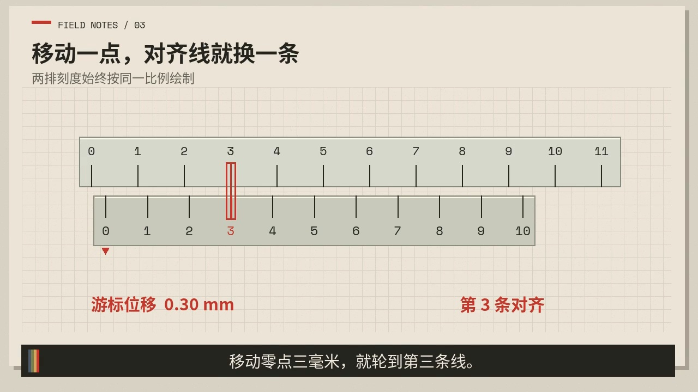](review/scenes/06-three.jpg)

用第二个位置重复规则，让观众看到“第几条对齐”对应“零点后移动了几分”。

对应工作流：[06-three-01.json](workflows/06-three-01.json)、[06-three-02.json](workflows/06-three-02.json)

## 7. 先读主尺整数部分

[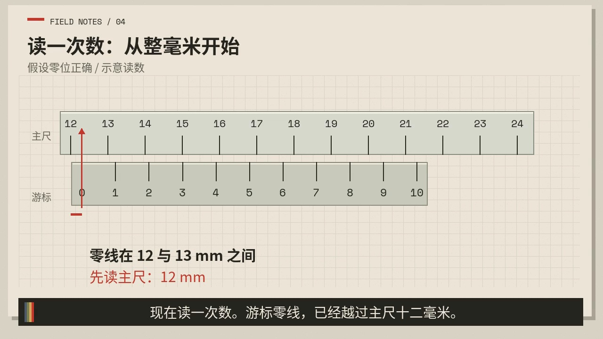](review/scenes/07-main.jpg)

先锁定游标零线越过的主尺整数刻度，避免把小数部分和整数部分混在一起。

对应工作流：[07-main-01.json](workflows/07-main-01.json)、[07-main-02.json](workflows/07-main-02.json)

## 8. 逐条寻找对齐线

[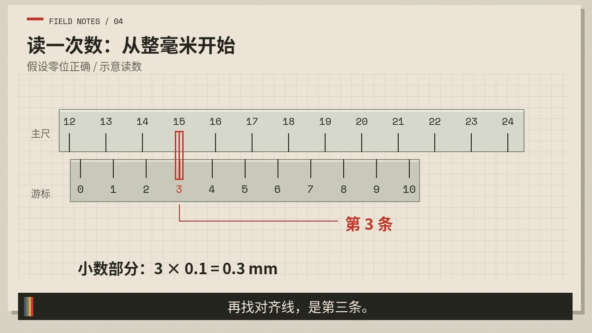](review/scenes/08-match.jpg)

游标刻度逐条扫描，最后停在第三条对齐线；这个动作承担真正的读数解释。

对应工作流：[08-match-01.json](workflows/08-match-01.json)、[08-match-02.json](workflows/08-match-02.json)

## 9. 展开读数公式

[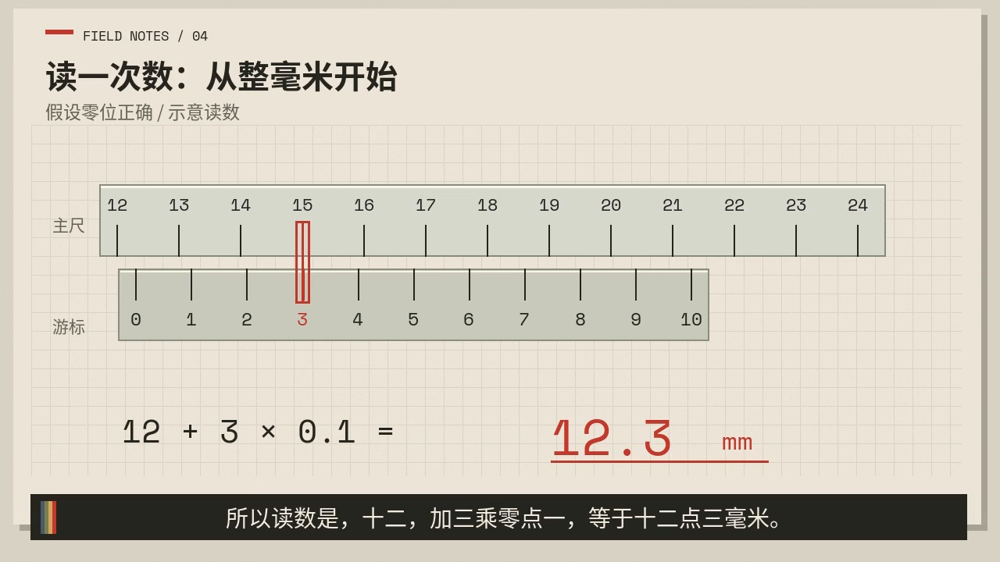](review/scenes/09-result.jpg)

把主尺读数、小数索引和分度值放在同一行，形成可复述的结论。

对应工作流：[09-result-01.json](workflows/09-result-01.json)、[09-result-02.json](workflows/09-result-02.json)、[09-result-03.json](workflows/09-result-03.json)

## 10. 回收核心直觉

[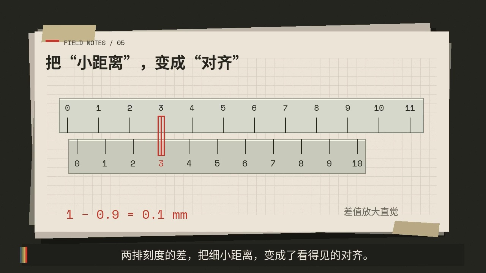](review/scenes/10-summary.jpg)

回到“两排刻度的差”，让结尾和开头的问题对应起来。

对应工作流：[10-summary-01.json](workflows/10-summary-01.json)、[10-summary-02.json](workflows/10-summary-02.json)

## 11. 说明适用边界

[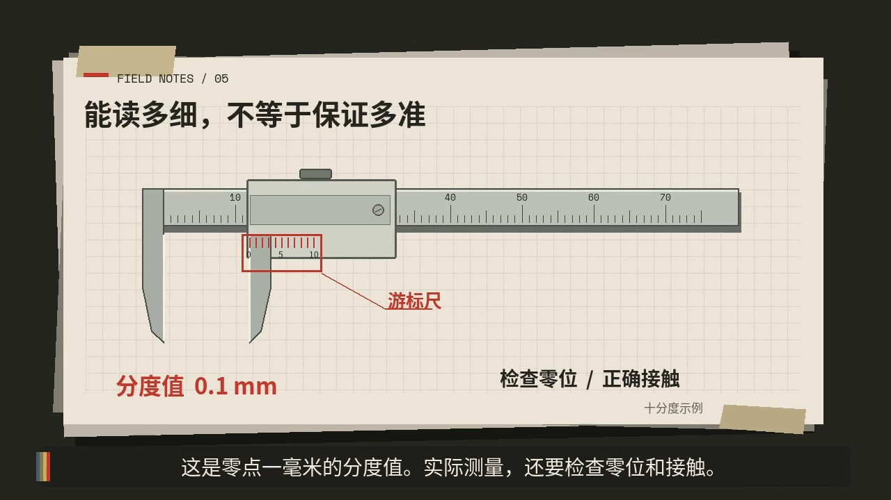](review/scenes/11-limits.jpg)

最后区分“能读多细”和“实际测得多准”，提示零位和接触条件。

对应工作流：[11-limits-01.json](workflows/11-limits-01.json)、[11-limits-02.json](workflows/11-limits-02.json)、[11-limits-03.json](workflows/11-limits-03.json)
