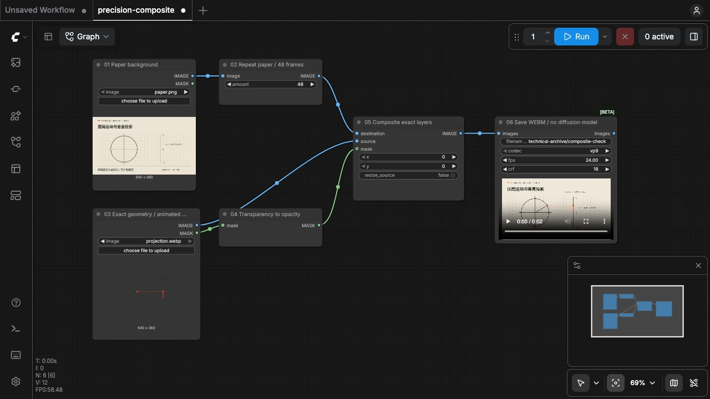
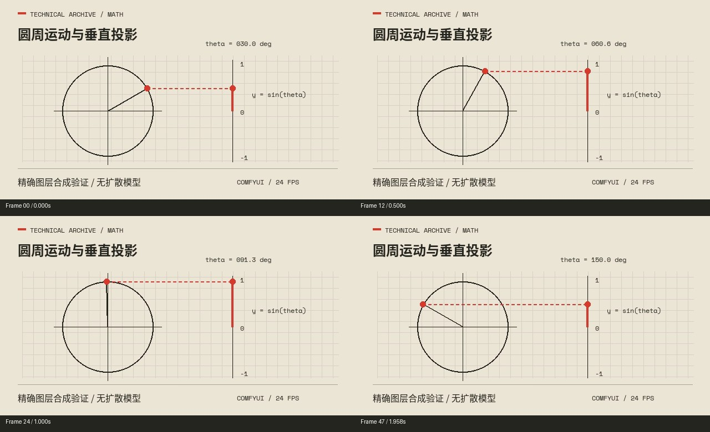

# ComfyUI 实测记录

测试日期：2026-10-31。

## 测试结论

随包工作流已实际运行：**预先计算的精确数学动画图层，可通过本次 ComfyUI 核心节点与底图合成并导出视频。**

API 队列执行成功；画布 JSON 也在实际前端载入并点击 Run，使用已有结果缓存。未运行文生图或图生视频模型，也未验证整片的旁白、字幕与音画配合。

## 环境

| 项目 | 本次配置 |
| --- | --- |
| ComfyUI | 0.34.0 |
| 前端 | 1.49.6 |
| Python | 3.13.12 |
| PyTorch | 2.12.1，CPU |
| PyAV | 18.1.0 |
| Pillow | 12.3.0 |
| 扩展 | 禁用自定义节点与 API 节点，仅使用核心节点 |

运行使用隔离的输入、输出、用户配置与临时目录。上述版本是此次验证记录，不代表其他版本已通过测试。

## 输入与节点

| 文件 | 说明 |
| --- | --- |
| [画布 JSON](../comfyui/precision-composite.json) | 用于 ComfyUI 前端导入 |
| [API JSON](../comfyui/precision-composite-api.json) | 同一计算图的 API 执行版 |
| [paper.png](../comfyui/input/paper.png) | 静态纸面、文字与坐标背景 |
| [projection.webp](../comfyui/input/projection.webp) | 透明数学动画，48 帧 |
| [输入生成脚本](../comfyui/make_demo_inputs.py) | 计算几何位置并使用随包字体绘制 |

动画演示单位圆上的点与其垂直坐标投影：角度从 30° 变化到 150°，位置由三角函数计算，图层包含点、半径、虚线与标签。没有用扩散模型生成公式或几何关系。

```text
LoadImage(paper.png) → RepeatImageBatch(48) ───────→ destination
LoadImage(projection.webp) → IMAGE ──────────────→ source
                          → MASK → InvertMask ──→ mask
                         ImageCompositeMasked → SaveWEBM
```

`LoadImage` 的 MASK 对透明区域取较高值；本次使用 `InvertMask` 转成合成需要的不透明度。背景复制 48 次以匹配前景帧数。

运行前读取 `/object_info` 确认节点存在，并检查当时的 ComfyUI 源码：

| 源码路径，相对 ComfyUI 安装目录 | 核对内容 |
| --- | --- |
| `nodes.py` | `LoadImage` 动画读取与透明度约定 |
| `comfy_extras/nodes_mask.py` | 蒙版反转与图层合成 |
| `comfy_extras/nodes_images.py` | 背景批次复制 |
| `comfy_extras/nodes_video.py` | 本次使用的 `SaveWEBM` |

## 运行与输出检查

- API 提交返回 `node_errors: {}`，历史状态为 `success`、`completed: true`。
- 画布 JSON 在前端 1.49.6 成功载入，点击 Run 后成功取得结果；此操作命中缓存，不算第二次独立渲染。
- 输出副本：[composite-check.webm](../comfyui/verification/composite-check.webm)。
- 输出探测：VP9、640×360、24fps、2.000 秒，无音轨。
- 完整解码为 48 帧；两个红色位置标记共 96 个预期位置均通过检查。
- 抽看第 0、12、24、47 帧，确认纸面、文字、投影与标注可见。
- 演示所用中文字已检查随包中文 Regular / Bold 字形覆盖，无缺字。





## 日志中的已知提示

测试日志并非全程无错误提示：

- 数据库初始化出现 `source code string cannot contain null bytes`。本次未修复该独立问题，服务器及本次队列仍成功运行。
- 读取动画 WebP 出现 `pyav decode error`，随后回退到图像序列读取。最终导出的 48 帧已完整检查。

以上记录保留已知限制，不将本次运行描述为日志零报错。

## 未验证范围

- 任意文生图或图生视频模型的推理、权重、显存及结构稳定性。
- Wan2.2 等模型在本风格下的画面质量与动作准确性。
- 其他电脑、ComfyUI 版本、自定义节点和模型组合。
- 长片的录音、字幕、镜头拼接、配乐与混音全流程。
- 完整影片按正常速度进行的人工有声语义验收。

演示没有配音或字幕时间轴，也没有完整知识叙事；静态帧图和位置检查不能代替有声样片验收。正式工程需先按自己的资料、模型、录音和图层验证代表性样段。

## 技术参考入口

- [ComfyUI 工作流基础](https://docs.comfy.org/basic-concepts/workflow)
- [Wan2.2 官方视频工作流示例](https://docs.comfy.org/tutorials/video/wan/wan2_2)

官方示例用于了解节点、模型与输入路线。文档提供某种能力，不等于本仓库或团队现有环境已经实测该路线。此前由 HTML/SVG/GSAP/HyperFrames 制作的 NASA 风格重建同样不属于本次 ComfyUI 验证。
