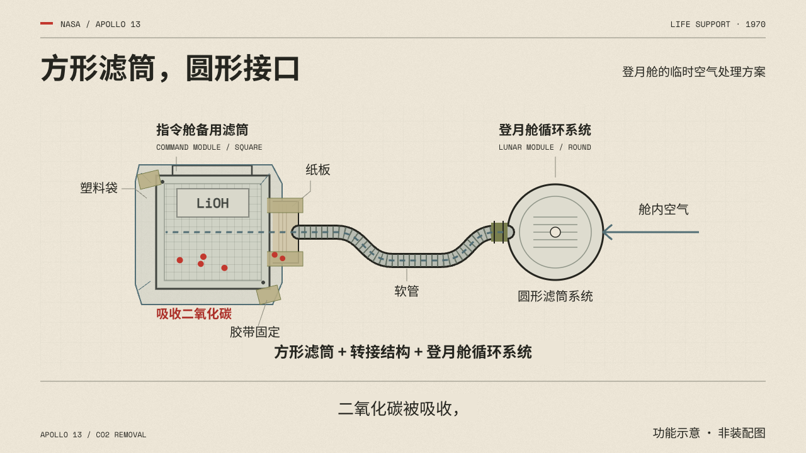

# 从旁白到画面的分镜模板

先分析含义，再设计动作。写稿阶段可填写相对顺序；录音完成后再补实测时间。

## 1. 统一时间约定

| 字段 | 本次记录 |
| --- | --- |
| 旁白版本 | [填写] |
| 对应录音文件 | [填写] |
| 时间单位 | [秒 / 毫秒；明确选一项] |
| 时间轴范围 | [全片 / 某个局部样段] |
| 局部时间到全片的偏移 | [填写；确认为零才写 0] |
| 锚点取得方式 | [词级对齐 / 实测短语 / 人工听音定位 / 待校准] |

不要将短语起点继续拆成虚构的词级时间。时间换算为：全片秒数 = 按单位换算后的局部秒数 + 段落偏移秒数。来源是全片时间时，不重复加偏移。

## 2. 填写表

一个信息节拍不一定等于一句话，也不一定等于一个切镜。

| 节拍 ID | 台词锚点 / 对应短语 | 实测起止时间 | 对象与初始状态 | 可见变化与结束状态 | 关系 / 要理解的事实 | 完成后的阅读停留 | 素材 / 来源 / 待办 |
| --- | --- | --- | --- | --- | --- | --- | --- |
| B01 | [填写] | 待校准 | [具体对象] | [具体动作] | [一句话] | [待按录音排练] | [填写] |
| B02 | [填写] | 待校准 | [沿用或新增对象] | [具体动作] | [一句话] | [待按录音排练] | [填写] |

“具体动作”应能画出来，如“同一只方形滤筒移到圆形轮廓上，四角外露”。“展示危机”“画面有科技感”“镜头震撼”不足以指导制作。

## 3. 改换题材也能保留的动作语法

| 信息关系 | 可套用的动作 | 不足以说明关系的做法 |
| --- | --- | --- |
| A 与 B 不同 | 统一尺度对齐、叠合，圈出差异 | 两张照片先后淡入 |
| A 替代 B | 同位置更换状态，保留时间及旧状态线索 | 同时摆两个图标 |
| A 导致 B | 沿因果方向逐步改变，停在结果 | 先把全部箭头亮出来 |
| A 与 B 组成 C | 两者接合，连接点与组成结果清楚 | 仅更换为 C 的整张图 |
| 数量或尺度改变 | 基准保持、刻度与对象同步变化 | 用大字重复旁白数字 |
| 规则被应用 | 在具体对象上展示规则前后 | 只翻出一页密集说明 |

## 4. NASA 新故事示例

以下根据既有阿波罗滤筒图解样段总结动作方法。用作功能关系示例，具体历史描述须沿本次来源核对；不是实际装配尺寸、管线长度或浓度数据。

| 台词要说明什么 | 画面对象 | 可见变化 | 让观众理解什么 | 阅读停留 |
| --- | --- | --- | --- | --- |
| 两套设备的滤筒形状不同 | 方形滤筒、圆形系统轮廓 | 同场并列，分别标明名称 | 材料能工作与能否安装是两件事 | 看清形状与名称 |
| 现有滤筒无法直接接入 | 沿用同一只方形滤筒 | 移到圆形轮廓上，四角差异显现 | 问题出在接口关系 | 保留叠合后的差异 |
| 现成材料形成转接结构 | 滤筒、纸板、塑料袋、胶带、软管 | 依台词顺序包合与连接 | 新办法来自重新组织已有部件 | 保留完整结构 |
| 系统开始推动空气经过吸收材料 | 循环系统、出风软管、转接结构、滤筒 | 按系统 → 软管 → 转接结构 → 滤筒运行 | 接通了具有方向的通路 | 流程走完后再归纳 |
| 处理后的空气回到舱内 | 滤筒出口与舱内 | 回路逐步画到舱内，抵达后出现箭头 | 气流经过处理后继续循环 | 完整回路与结论同场保留 |

示例未附录音，所以表内没有实测时间。新片必须从本次录音重新建立锚点，不照搬旧样段秒数。

## 5. 工程与数学选题的分镜示例

| 题材 / 台词含义 | 对象与变化 | 精确内容 | ComfyUI 分工 |
| --- | --- | --- | --- |
| 传动：输入转动后输出怎样变化 | 固定中心与齿形，按传动关系同时转动 | 齿数、转向、角位移、接触关系 | 外壳可生成；关键机构与运动精确绘制后合成 |
| 结构：这股力沿哪里传递 | 保留结构和支撑，沿实际分析逐段显示箭头 | 支撑条件、力的方向和简化模型 | 材质可生成；结构和箭头使用核实图层 |
| 导数：两点靠近时割线怎样变化 | 在同一函数上移动采样点，重新计算割线，逐步逼近 | 函数、采样点、斜率、坐标尺度与适用条件 | 纸面可生成；曲线、线段、数值由计算绘制 |
| 矩阵：变换后区域发生什么 | 网格、基向量与区域按同一矩阵变化 | 变换结果、方向、面积比例 | 纸面与材料层可生成；变换动画和公式精确合成 |

这些是可执行的分镜模式，不是某个扩散模型的动作保证。新选题按自己的资料与录音校时。表格可另加“图像正向文本、视频动作文本、输入素材、节点版本、输出路径”字段，避免把编导说明当成节点提示词。

## 6. 每个节拍的自检

- 关掉字幕后，能否看出正在比较、替换、装配或运行什么？
- 保留字幕后，是否恰好说明当前对象的变化？
- 结果是否在观众还没辨认对象时就提前出现？
- 动作结束后，有没有时间读清关键差异、数字或路径？
- 引线、数值和图解是否仍指向同一个对象？

关掉字幕自检用于确认动作有解释力，不表示静音观看能代替完整有声验收。
