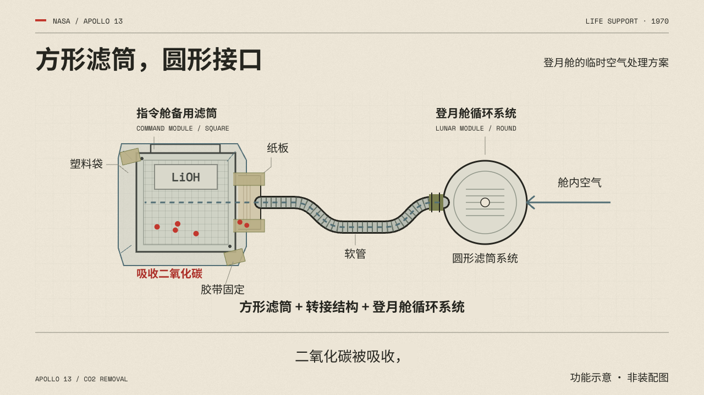

# 风格说明

## 1. 先抓住这个风格

**复古技术档案 × 动态图解科普**是本团队的制作名称。NASA 视频是风格参考，题材以工程和数学为重点，也能用于相关知识科普；无需航天对象或历史背景。适用范围详见 [TOPIC_FIT.md](TOPIC_FIT.md)。

它像一位讲解者在桌面上翻阅技术手册和研究笔记：先拿出一件实物、一张照片或一个数学问题，再摆上证据、条件和草图，圈出细节，用图解演示原因，最后把线索收束成一个结论。

风格由四件事共同成立：

- **依据感**：真实照片、技术资料、数学定义、已知条件和来源让内容有依据。
- **秩序感**：网格、字体层级、编号、细线与对齐组织复杂信息。
- **材料感**：纸张、胶带、剪贴边缘、轻微透视和阴影形成桌面空间。
- **解释性**：旁白说到的变化，要由对应对象及其关系演出来。

## 2. 怎样理解参考片的画面

视觉参考为路北路陈《设计风格小课 04》，原片入口见 [来源说明](SOURCES.md)。公开仓库保留署名与链接，不附带原片截帧。

| 画面类型 | 可观察的组织方法 | 新主题可以怎样使用 |
| --- | --- | --- |
| 实物入题 | 从照片中的一个标志或细节进入问题 | 从齿轮、梁、电路或待解释的图形开始 |
| 纸面分析 | 纸面、网格、字标和有限的强调色 | 展开定义、几何关系、结构与测量 |
| 规范与测量 | 叠放手册、局部放大与尺寸线 | 对照约束、参数和方案差别 |
| 证据桌面 | 深色桌面、照片纸边与资料分类 | 建立资料层次，指出当前解释的依据 |
| 结尾归纳 | 将多个已出现的案例整理到同一页 | 回收问题，让结论与前面的对象对应 |

原片包含真实航天照片与游戏设备案例，二者不能混为历史证据。新片需按自己的资料取得生产素材。

本仓库的自制功能图解示例：



此图是较简洁的机制图解变体，只说明功能关系，不表示真实尺寸与管线形状；它不代替原片中的照片、深浅场景和叠纸层次。数学精确图层的运行示例见 [ComfyUI 实测记录](COMFYUI_VERIFICATION.md)。

## 3. 叙事模板

建议的信息路径：

**一个具体细节 → 一个值得追问的问题 → 必要背景 → 两三个证据或机制 → 转折或限制 → 回答开头。**

按题材调整顺序。历史故事可以倒叙，机制解释可以直接从故障或不匹配开始，不固定章节数量。

工程可用“需求 → 约束 → 结构 → 运行 → 结果与代价”；数学可用“具体问题 → 图形或数量关系 → 变换或推导 → 条件 → 结论”。数学题不必编造人物史或旧文件，工程题也不必强行设悬念。

| 环节 | 观众需要得到什么 | 写作方法 |
| --- | --- | --- |
| 开场 | 看见具体物件，产生疑问 | 从照片、标记、装置、一次操作进入 |
| 背景 | 知道谁在什么条件下遇到什么问题 | 只交代理解后文所需的年代、人物和限制 |
| 展开 | 看懂原因和证据 | 每段推进一个问题，用实物细节接入机制 |
| 转折 | 修正一个直觉或揭示约束 | 让材料、接口、制度、任务条件推动变化 |
| 收束 | 带走可复述的结论 | 回到开场的物件，指出现在能看懂的关系 |

旁白气质是冷静、好奇、口语化，有少量机智。以名词和动词推进，少堆“震撼”“史诗”“难以置信”等评价。允许长短句变化和有意义的停顿。术语第一次出现先解释它做什么，再给名字。

每段尽量回答一个明确问题。日期服务于事件关系，数字服务于比较，引用服务于证据。不要为了显得像档案而填满无关数字与英文。

新故事要重新选择中心问题、资料和因果线。不要将参考片逐句替换同义词，再把 NASA 改成另一个名字。

## 4. 哪些保留，哪些替换

| 保留的风格规则 | 每次按题材替换 |
| --- | --- |
| 档案材料与工程图解互相支撑 | 机构、年代、人物、物件、史料 |
| 纸面、深色桌面、照片的层次关系 | 场景数量、切换顺序、历史或机制的占比 |
| 字体分工、网格对齐、细线与红色重点 | 正文、数据、真实标志及其使用条件 |
| 比较、拆解、测量、替换、连接等讲解动作 | 具体要比较的形状、要连接的通道 |
| 用实际录音校准统一时间轴 | 旁白音色、语速、每段长度与停顿 |
| 结尾回到问题并保留结果供阅读 | 新故事最终要说明的结论 |

这里的纸面与深色桌面要共同构成材料层次。不要把整片简化为统一浅色底、居中图标和大字幕。也不用机械规定深浅场景各占多少。

## 5. 颜色和材料

以下数值来自团队复现方案，可直接用于新工程；不是从原片工程读取的精确参数。

| 用途 | 颜色 | 使用方式 |
| --- | --- | --- |
| 纸面 | `#ECE5D6` | 分析页、手册、纸签，保持文字清晰 |
| 深墨 / 桌面 | `#25251F` | 主文字、暗底、照片展示空间 |
| 次要文字 | `#5A594F` | 来源、分类、辅助说明 |
| 网格 | `#C8C3B7` | 低对比工程辅助线 |
| 重点红 | `#D63A2C` | 问题、差异、圈注、关键节点 |
| 窄幅彩条 | `#4C5A68` / `#7A7F4E` / `#D2A85E` / `#A8432F` | 页脚或身份标记，少量使用 |

红色优先标记当前讲解重点。原始照片和图表有自己的信息颜色时保留，不为统一配色删掉事实。小号红字需要实际检查对比度，必要时使用更深的红色。

纸张应有轻微纤维、折痕或印刷不均，程度以不妨碍阅读为准。胶带、纸边和软阴影解释叠放关系。暗底仍需看得清楚设备细节。纹理可以静止，不需要持续闪动来制造“活着”的错觉。

新画面的物件与场景还可沿用原片总结的七层语汇：

| 层次 | 可以怎样表现 | 为什么存在 |
| --- | --- | --- |
| 底材 | 白灰色柜体、箱体、金属与涂层表面 | 先让设备像能被制造和使用的硬件 |
| 结构 | 面板、接缝、连接点、模块边界 | 让观众看出它如何组成与拆装 |
| 功能图案 | 黑白斜纹、方向线、定位或识别图案 | 服务辨认、安全和操作 |
| 功能标签 | 型号、编号、方向、警告、介质名称 | 交代设备身份与用途 |
| 身份 | 机构徽章、任务标记、窄幅彩条 | 提供所属关系与少量识别色 |
| 强调 | 一个关键拉片、按钮、接口或红色标注 | 把视线引向当前要操作或解释的位置 |
| 痕迹 | 磨损、维修胶带、手写便签、局部破损 | 表现使用与修补经历，而非均匀撒污渍 |

这是分析和设计工程素材的方法，不要求每个镜头凑齐七层。历史设备按真实资料呈现，不能随意加上不存在的标签或损坏。新生成的示意对象在材质、轮廓和标注上保持一致；只画与本段解释有关的结构，避免以无意义管线和伪文字堆出复杂感。

数学选题将“设备底材、接缝”换成研究纸面、坐标系、几何对象、分区、变量标签与推导步骤。保留纸张、墨色、网格、克制红色和阅读节奏，不给公式硬贴金属壳、维修胶带或无关编号。抽象知识可以用这套排版，但不由“复古”推断它一定来自某个历史时期。

默认做纸张、照片与图解的二维或轻度立体拼贴。新主题的物件与图层保持这套材料和版式关系。

## 6. 字体与版式

| 内容 | 随包字体 | 作用 |
| --- | --- | --- |
| 中文标题、解释、字幕 | Noto Sans SC Regular / Bold | 保证中文与数字识别 |
| 拉丁标题 | Archivo | 紧凑、有力量的标题层级 |
| 年份、编号、技术标签 | Space Mono Regular | 工程与档案语气 |
| 真实机构字标 | 来自可靠资料的矢量或图片 | 保持原有几何与比例 |

这些字体是便于复现和分发的选型。历史手册提到的 Helvetica、Univers 等属于被讲述的设计事实，不能据此宣称本包字体就是原片字体。

建议默认 16:9、1920×1080、30fps。以下字号为团队起始值，需按实际观看尺寸检查：主标题 56–88px，解释文字 30–40px，重要标注 26–34px，字幕 32–40px。16–22px 的小标签只承担非必要元信息，不放核心结论。字距从 0 开始，避免靠挤压字形塞入文字。

常用布局：

1. 上部放章节、类别、年份等定位信息。
2. 中部给一个主对象或一组有比较关系的对象。
3. 对象附近放名称、测量线和局部解释。
4. 下部保留结论区与独立字幕区，两者不互相挤占。

四周先留约 5% 安全区，再按画面调整。连续镜头保留共同的对齐轴。照片允许有小幅倾斜和纸边，文字页尽量平稳；重要数字与标注保持正向易读。

竖版要重新布局对象、标注与字幕，不能将横版中央机械裁切。最终成片要在目标设备尺寸检查。

## 7. 五类可复用场景

| 类型 | 画面组织 | 必须完成的解释 |
| --- | --- | --- |
| 实物入题 | 真实照片或设备占主要视野，局部标注出现 | 让观众知道正在讨论哪个细节 |
| 纸面分析 | 网格纸、图形、测量线、少量说明 | 把形状、比例或规则讲清楚 |
| 证据桌面 | 深色桌面上叠放手册、照片与引文卡 | 显示资料之间的关联，定位证据 |
| 机制图解 | 保留对象，逐步拆分、移动、接合、运行 | 让关系或流程在眼前成立 |
| 归纳档案页 | 将前文已经出现的对象重新排列 | 从案例推出结论，回收开场 |

按信息需要选择，不要求每片五类齐全。真实资料负责证据，图解负责可见的机制；两者切换时保持对象名称、颜色和方向的一致性。

## 8. 动画必须在解释什么

| 旁白含义 | 应有的画面动作 | 动作后的停留 |
| --- | --- | --- |
| 两者不同 | 同一尺度并列、叠合或对齐，差异被圈出 | 留出比较时间 |
| 某部分被移除 | 在同一对象上明确显示前后状态 | 保留变化后的形状 |
| 某物多高、多大 | 标尺或基准物随量值展开 | 数字、对象与基准同时可读 |
| 零件如何组成系统 | 零件依序接合，连接点可见 | 完成后保持整体结构 |
| 流体、信号或材料经过路径 | 按正确方向逐段运行 | 到达后再出现结果标识 |
| 某规则被替换 | 新旧状态与年份同场比较或沿时间线变化 | 保留前后关系 |
| 结论成立 | 回到前文对象，将关键关系收束 | 不立刻切黑或塞入新信息 |

每个节拍用“对象—动作—关系—结论”自检。比如讲接口不匹配，就让同一个方形对象移到圆形接口处，露出差异；随后展示转接结构怎样建立连接。只在旁边写“不兼容”并放大整页，不足以完成这一解释。

局部放大服务于辨认细节，拉远服务于恢复全貌。引线与被解释对象放在同一坐标或变换关系里；对象移动时，标注跟随或有目的地收起。照片中的设备轮廓不因动画需要被随意拉伸。

一般可从 0.25–0.6 秒的入场或标注动作开始尝试，复杂装配、比较与循环按含义延长；动作完成后可先预留 0.8–2 秒读图。这是排练建议，不是固定节拍，也不是从原片测得的动作时长。

## 9. 录音、节奏与声音

先锁定事实与主要旁白，再录最终配音；用实际词或短语的开始、结束时间来排动作。草稿阶段可以标预估时长，但必须与实测字段分开，未找到的锚点写“待校准”。

每个动作一般在相关关键词附近开始，在结论被说出时让观众看清结果；具体前后关系取决于解释需要，不做统一提前量。不要让下一句尚未解释的关键结果提前出现。

配音清楚、克制、有停顿，像在带人查看资料。可使用合适的真人或合成声，不需要复制参考作者的声纹。

背景音乐用低存在感的器乐或电子质感，随叙事密度收放；纸页、印章、接合、标注等音效只标记有意义的动作。不要求每次切镜都发声。已有参考无法可靠确认的原片音乐、BPM 或混音参数，不编写成风格事实。

旁白始终清晰可辨。无配乐也可完成解释样段。音乐不迫使旁白加速或改变事实顺序。

## 10. 素材提示词

可用于生成工程类补充场景或对象参考的基础描述：

```text
复古技术档案与工业技术手册的视觉语言，真实机械与材料，
白灰色设备底材，可理解的面板接缝与模块结构，
有功能依据的方向线、警告图案、编号和身份标记，
平整旧纸、细工程网格、深墨线条、少量红色标注，
摄影剪贴边缘、胶带和克制阴影，明确的对象关系，
低饱和但保留设备本来颜色，清楚可检查的功能细节，
局部真实的磨损与修补痕迹，关键操作部位使用少量强调色。
主体为【对象】，用于解释【关系】，为【标注位置】留白。
```

图中中文、数据、机构标志和关键技术线条在后期用可编辑对象排版，不依赖图片模型直接生成。真实设备与历史证据优先使用核实过的资料；此提示词不保证历史或结构准确。

数学画面将素材描述改为“研究笔记纸面、干净留白、为坐标图与公式合成预留区域”，精确图形与公式单独制作。以上是美术描述；ComfyUI 文本编码节点使用 [COMFYUI_PROMPTS.md](COMFYUI_PROMPTS.md) 中拆分后的内容，不将整份制作规范当作生成提示词。

## 11. 最常见的偏离

- 只剩旧纸、红字和大标题，缺少照片、证据与对象变化。
- 每句话都换一张图片，观众看不出对象之间发生了什么。
- 把原片的叠纸、阴影和桌面空间简化成统一浅色幻灯片。
- 用霓虹、全息、宇宙粒子和夸张镜头替代具体的工程说明。
- 为赶节拍删掉比较、装配和结果阅读的时间。
- 字幕、结论、年份和装饰标签同时争抢一个区域。
- 不核对素材结构或资料，把生成画面当成历史照片。
- 用旧文案的字体子集或旧录音时间轴套新稿。

验收时先问观众能否看懂对象关系，再检查材质、配色与装饰。详细执行表见 [CHECKLIST.md](CHECKLIST.md)。
